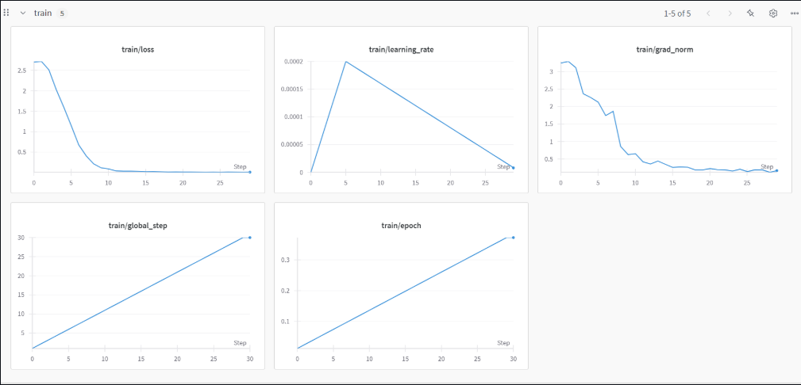
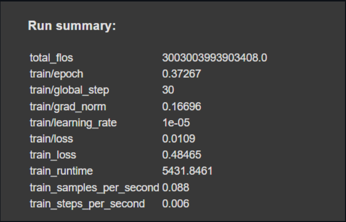
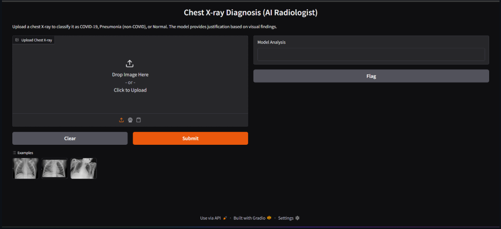
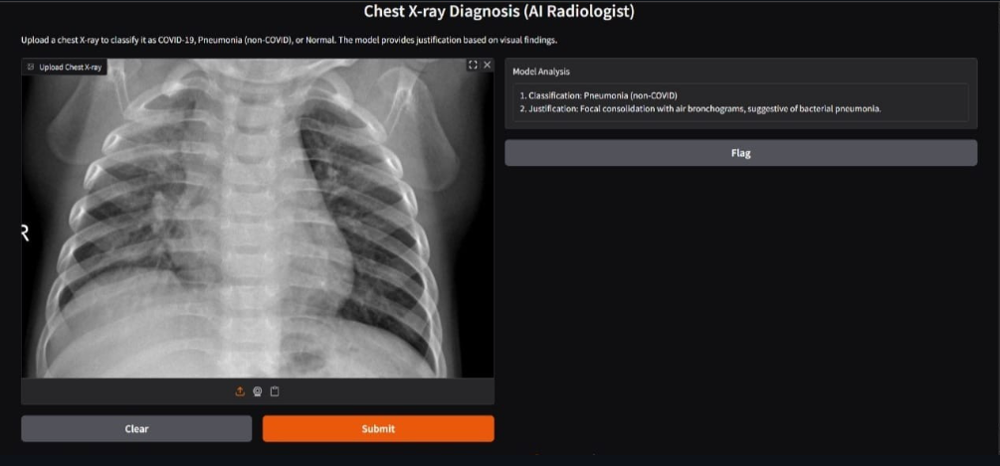

# 🩻 Chest X-ray Diagnosis (AI Radiologist)

An AI-powered diagnostic application that analyzes chest X-ray images to classify them as COVID-19, Pneumonia (non-COVID), or Normal, providing clinical justifications based on visual features. 

[](https://huggingface.co/Suman2004/covid_chestXray_radiologist)
[](https://huggingface.co/datasets/Suman2004/covid_chestXray)

## 📁 Project Structure
```
Chest-X-ray-Diagnosis-main/
├── llama_3.2_11b_vision_finetuning_kaggle.ipynb   # Fine-tuning notebook (Unsloth + QLoRA, run on Kaggle/Colab T4)
├── finetuned_llama_3.2(11B)_vision_testing.ipynb  # Inference + Gradio app notebook (run on Colab)
└── README.md                                      # Project documentation
```

## 🔄 Project Workflow
1. **Fine-tune** (`llama_3.2_11b_vision_finetuning_kaggle.ipynb`): load Llama 3.2 11B Vision in 4-bit, attach LoRA adapters, train on the chest X-ray dataset, then push the model to the Hugging Face Hub.
2. **Test & Deploy** (`finetuned_llama_3.2(11B)_vision_testing.ipynb`): pull the fine-tuned model from the Hub, test on single images, and launch the Gradio web app.

## 🛠️ Tech Stack & Tools
* **Base Model:** `unsloth/Llama-3.2-11B-Vision-Instruct`.
* **Fine-Tuning Framework:** `unsloth` for highly optimized, memory-efficient vision-language model training.
* **Quantization:** `bitsandbytes` for 4-bit model loading (QLoRA).
* **Deep Learning Backend:** PyTorch (`torch`, `torchvision`).
* **Hugging Face Ecosystem:** `transformers`, `peft`, `datasets`, and `huggingface_hub`.
* **User Interface:** `gradio` web application.
* **Hardware:** NVIDIA Tesla T4 GPU (Google Colab / Kaggle environments).

## 🧠 Fine-Tuning Methodology 

### 1. 4-bit Quantization (QLoRA)
Training an 11-billion parameter vision-language model conventionally requires massive VRAM. To resolve this, the model was loaded in 4-bit precision using Unsloth's `FastVisionModel` (`load_in_4bit=True`). This drastically reduced the GPU memory footprint, enabling the entire fine-tuning process to execute on a single 16GB Tesla T4 GPU. Gradient checkpointing (`use_gradient_checkpointing="unsloth"`) was also enabled to further optimize memory for long-context vision tasks.

### 2. Parameter-Efficient Fine-Tuning (PEFT / LoRA)
Instead of updating all 11 billion parameters, Low-Rank Adaptation (LoRA) was applied to train only ~1% of the network. 
* **Target Modules:** Adapters were injected into both the vision encoder (`finetune_vision_layers=True`) and the language backbone (`finetune_language_layers=True`). Specifically, both the attention modules and MLP layers were fine-tuned. This dual-tuning approach is critical for VLMs to learn the mapping between pixel-level anomalies (radiography features) and text-level medical terminology.
* **Hyperparameters:** LoRA Rank (r) was set to 16, and LoRA Alpha to 16, ensuring an optimal balance between accuracy and overfitting. Dropout was disabled (`lora_dropout=0`).

### 3. Dataset & Instruction Formatting
The model was fine-tuned on the `Suman2004/covid_chestXray` dataset containing 1,288 structured examples of X-rays paired with expert radiologist descriptions. The instruction pipeline was strictly formatted into a chat-style template using system prompts. The model was trained to follow this specific schema:
1. **Classification:** [Condition Name]
2. **Justification:** [Clinical Findings]

The dataset labels were mapped to class names (`0 → COVID-19`, `1 → Normal`, `2 → Pneumonia (non-COVID)`), each paired with a clinical justification (e.g. bilateral ground-glass opacities for COVID-19, focal consolidation with air bronchograms for pneumonia, clear lung fields for normal). Each sample was converted into a two-turn conversation (user: instruction + image, assistant: formatted answer) as required by Unsloth's vision data collator.

### 4. Baseline Check (Before Fine-Tuning)
Before training, the base model was prompted zero-shot on a sample X-ray. It produced a long, step-by-step free-form answer (with a made-up confidence score) instead of the required structured format, which motivated the fine-tuning.

### 5. Training Configuration
Training used Hugging Face TRL's `SFTTrainer` with `UnslothVisionDataCollator`, and was tracked with Weights & Biases (project `covid-19`).

| Parameter | Value |
|---|---|
| Training examples | 1,288 |
| Max steps | 30 (1 pass over a sampled run) |
| Per-device batch size | 2 (as configured; Unsloth logged an effective 4) |
| Gradient accumulation steps | 4 |
| Total effective batch size | 16 |
| Warmup steps | 5 |
| Learning rate | 2e-4 (linear scheduler) |
| Optimizer | `adamw_8bit` |
| Weight decay | 0.01 |
| Max sequence length | 2048 |
| Precision | `fp16` on T4 (`bf16` if supported) |
| Seed | 3407 |
| Trainable parameters | 67,174,400 / 11B (0.61%) |

### 6. Training Results & Resource Usage
| Metric | Value |
|---|---|
| GPU | Tesla T4 (14.74 GB) |
| Training time | ~5,432 s (≈ 90.5 min) |
| Peak reserved memory | 13.99 GB (94.9% of GPU) |
| Peak memory used for training | 5.25 GB (35.6% of GPU) |

After fine-tuning, the model follows the required output format exactly, e.g.:
```
1. Classification: Pneumonia (non-COVID)
2. Justification: Focal consolidation with air bronchograms, suggestive of bacterial pneumonia.
```

### 7. Saving & Publishing
The trained LoRA adapters and tokenizer were pushed to the Hugging Face Hub (`push_to_hub`), and the merged 16-bit model was also uploaded (`push_to_hub_merged`) to [`Suman2004/covid_chestXray_radiologist`](https://huggingface.co/Suman2004/covid_chestXray_radiologist) so it can be loaded directly with `transformers` for inference.

## ⚡ Inference & Application Architecture

### 1. Model Loading & Generation
For inference, the custom fine-tuned weights (`Suman2004/covid_chestXray_radiologist`) are pulled from the Hugging Face Hub using `AutoModelForImageTextToText` and cast to `torch.float16` to maximize inference speed on CUDA devices. The `AutoProcessor` handles the simultaneous tokenization of the text prompt and preprocessing of the PIL image.

To improve the user experience during long clinical generations, a `TextStreamer` is implemented. This streams the diagnostic tokens sequentially as they are generated (`max_new_tokens=300`, `temperature=1.2`, `top_p=0.9`), eliminating long blocking times.

Single-image testing is done first (e.g. a Normal X-ray returned `Classification: Normal` with the justification "No focal consolidations or opacities observed. Lung fields appear clear."), followed by the Gradio app.

### 2. Web Interface Deployment
The prediction logic is wrapped in a `gradio` interface (`gr.Interface`). The application dynamically applies the model's `chat_template` behind the scenes, ensuring the end-user only needs to upload an image via the UI to trigger the inference pipeline. To mitigate high hosting costs for an 11B VLM (requires 15GB+ VRAM), the Gradio app is configured with `share=True` to serve the application directly from the Colab GPU environment for testing.

## 📊 Training Details
Below are the training graphs demonstrating the loss reduction during the finetuning process:
  
  

Run summary logged during training:
  
  

## 🖥️ User Interface
This system provides a clean Gradio user interface for immediate testing.




Testing the application with an input:



## 🚀 How to Run
1. **Fine-tuning:** open `llama_3.2_11b_vision_finetuning_kaggle.ipynb` on Kaggle/Colab with a T4 GPU, add `HF_TOKEN` and `wandb_api_key` as secrets, and run all cells.
2. **Inference / UI:** open `finetuned_llama_3.2(11B)_vision_testing.ipynb` on Colab (GPU runtime), add `HF_TOKEN` as a secret, upload sample images (`Normal.jpg`, `Pneumonia.jpg`, `covid.jpg`), and run all cells to get a public Gradio link.

## ⚠️ Disclaimer
This project is for educational and research purposes only and is not a substitute for professional medical diagnosis.

